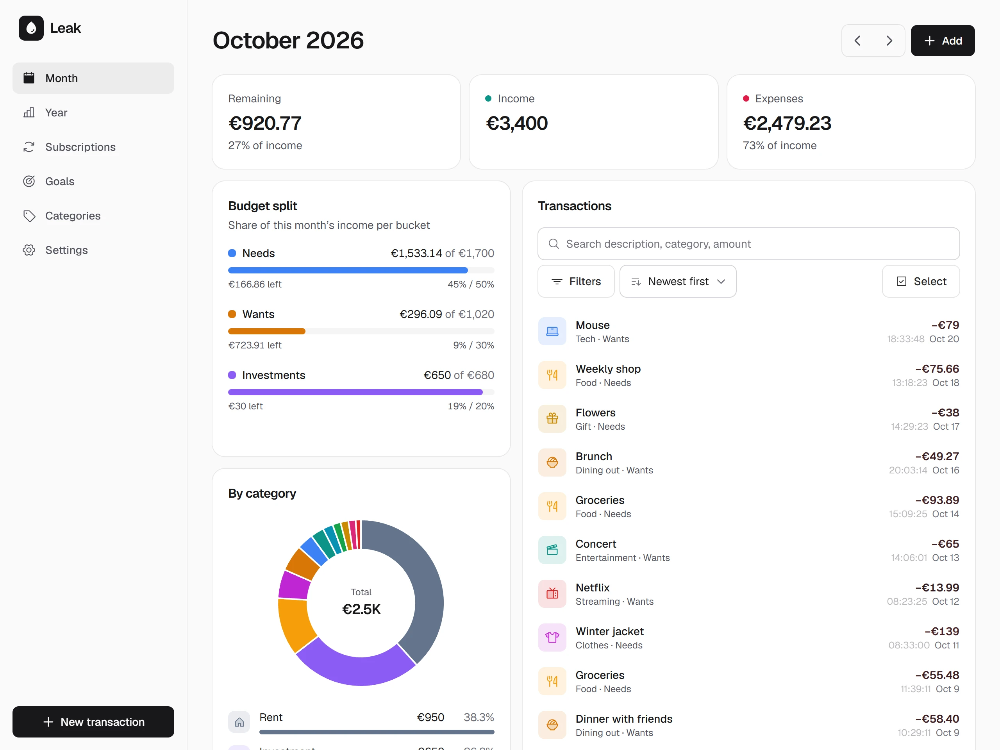
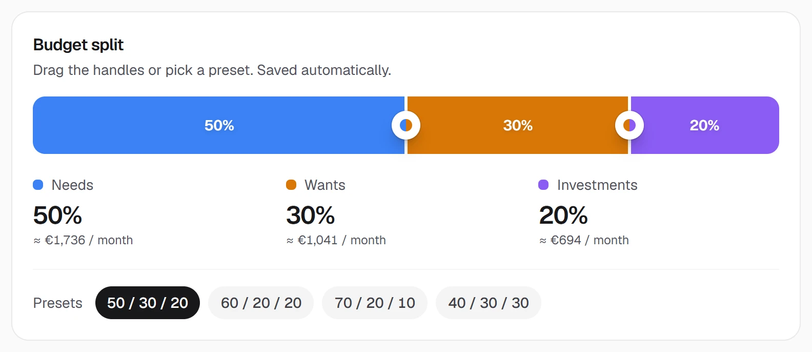
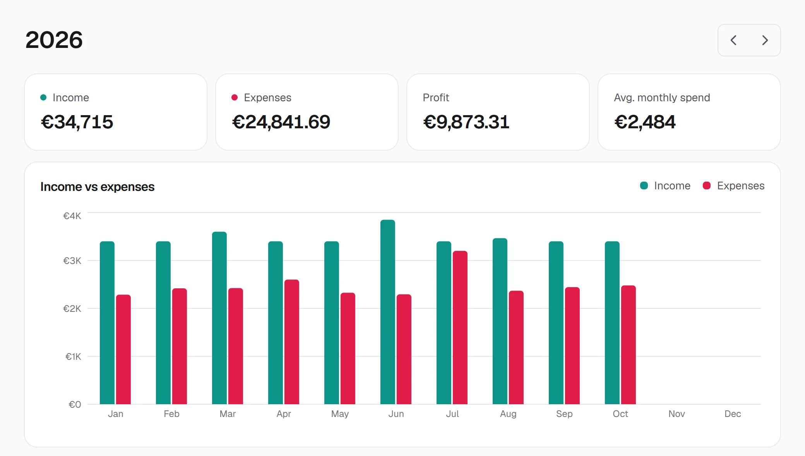
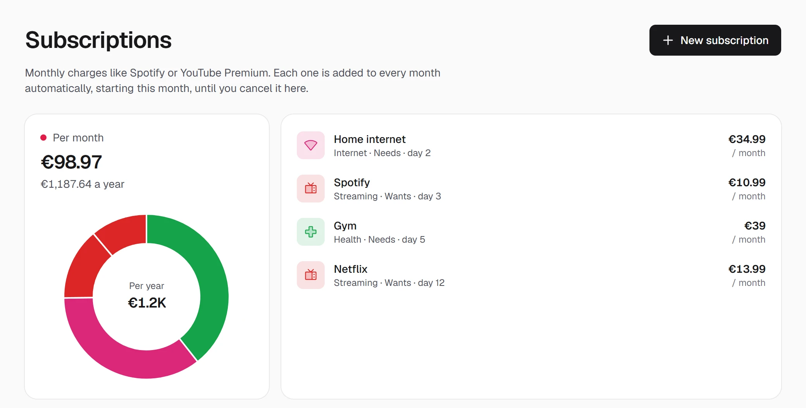
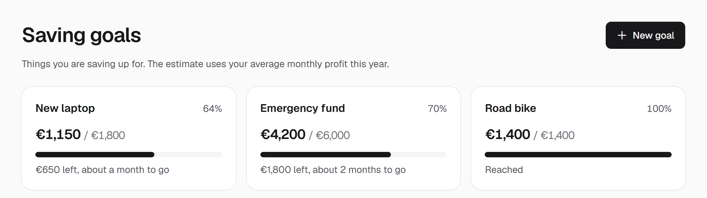
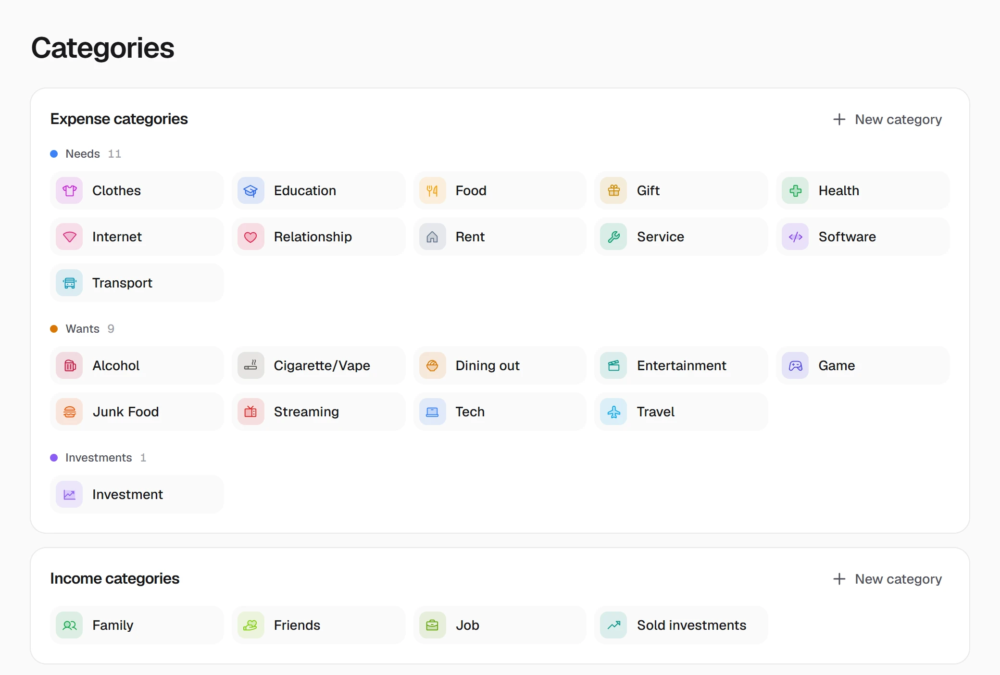
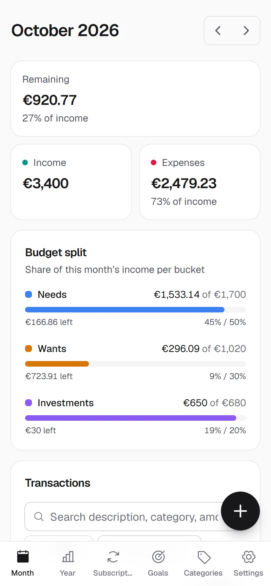
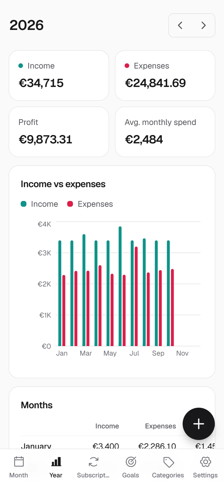
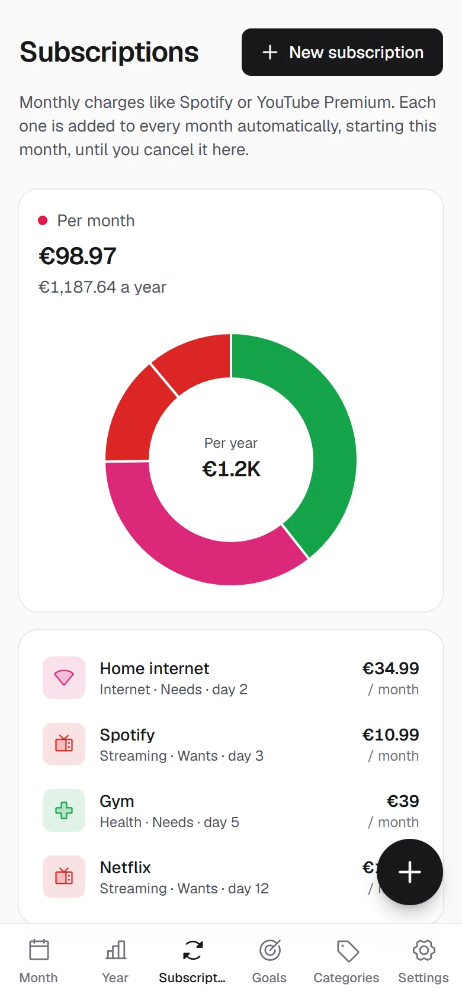

<div align="center">


# Leak

**See where your money leaks.** A personal finance tracker built around the 50/30/20 rule.

[](https://github.com/KantorIstvan/leak/releases/latest)
[](#install)
[](LICENSE)

[**Download**](https://github.com/KantorIstvan/leak/releases/latest) &nbsp;&nbsp;&nbsp; [Features](#features) &nbsp;&nbsp;&nbsp; [Development](#development)

</div>

<br>

<picture>
  <source media="(prefers-color-scheme: dark)" srcset="docs/screenshots/month-dark.webp">
  
</picture>

## How it works

Every month your income is split into **Needs** (rent, groceries, bills), **Wants** (eating out, games, travel) and
**Investments**, and Leak shows how your spending tracks against that plan. The split starts at 50/30/20 and is yours to
change: drag the handles or pick a preset.

<picture>
  <source media="(prefers-color-scheme: dark)" srcset="docs/screenshots/split-dark.webp">
  
</picture>

Leak is a desktop app for Windows, macOS and Linux. Sign in with Google, GitHub or an email code and your data syncs
to your account, so it survives a lost or broken computer.

## Features

**The year at a glance.** Income vs expenses for every month, a month-by-month table with averages and totals, and a
breakdown by category.

<picture>
  <source media="(prefers-color-scheme: dark)" srcset="docs/screenshots/year-dark.webp">
  
</picture>

<table>
<tr>
<td width="50%" valign="top">

**Subscriptions**<br>
Monthly charges like Spotify or your phone plan are added to every month automatically.

<picture>
  <source media="(prefers-color-scheme: dark)" srcset="docs/screenshots/subs-dark.webp">
  
</picture>

</td>
<td width="50%" valign="top">

**Saving goals**<br>
What you are saving for, and about how many months are left at your current pace.

<picture>
  <source media="(prefers-color-scheme: dark)" srcset="docs/screenshots/goals-dark.webp">
  
</picture>

</td>
</tr>
</table>

**Categories with icons.** Every category has a default bucket, and all of them are yours to rename, recolour or
delete.

<picture>
  <source media="(prefers-color-scheme: dark)" srcset="docs/screenshots/categories-dark.webp">
  
</picture>

**Works on small screens too.**

<p align="center">
  <picture>
    <source media="(prefers-color-scheme: dark)" srcset="docs/screenshots/mobile-month-dark.webp">
    
  </picture>
  &nbsp;
  <picture>
    <source media="(prefers-color-scheme: dark)" srcset="docs/screenshots/mobile-year-dark.webp">
    
  </picture>
  &nbsp;
  <picture>
    <source media="(prefers-color-scheme: dark)" srcset="docs/screenshots/mobile-subs-dark.webp">
    
  </picture>
</p>

**And the rest**

<table>
<tr>
<td width="50%" valign="top">

**Your data**

- Syncs across devices after signing in
- The last synced data stays readable offline
- Search, filters and bulk edit for transactions
- CSV import and export, also from other apps
- JSON backup export and import

</td>
<td width="50%" valign="top">

**Make it yours**

- Any display currency
- Hungarian and English UI
- Light and dark mode, custom colours
- Colour-blind mode
- 12 or 24-hour clock

</td>
</tr>
</table>

## Install

Download the installer for your system from the **[latest release](https://github.com/KantorIstvan/leak/releases/latest)**.

| System | File |
|---|---|
| Windows | `Leak_x.y.z_x64-setup.exe` |
| macOS, Apple Silicon (M1 or newer) | `Leak_x.y.z_aarch64.dmg` |
| macOS, Intel | `Leak_x.y.z_x64.dmg` |
| Linux | `.AppImage` (any distro), `.deb` (Debian/Ubuntu), `.rpm` (Fedora) |

> [!NOTE]
> The app is not code-signed yet, so the first launch needs one extra step:
>
> - **Windows:** on the "Windows protected your PC" screen click **More info**, then **Run anyway**.
> - **macOS:** open the `.dmg` and drag Leak to Applications. On first launch macOS blocks it; go to
>   **System Settings > Privacy & Security**, scroll down and click **Open Anyway**.
> - **Linux (AppImage):** make it executable with `chmod +x Leak_*.AppImage`, then run it.

After that, Leak offers new versions on launch and installs them in place.

Your data lives in your account, so it is there on every device you sign in on. On first sign-in, data from an older
version of Leak on that computer is uploaded automatically.

## Development

### Requirements

- [Node.js](https://nodejs.org) 20+
- For the desktop build: [Rust and the Tauri prerequisites](https://tauri.app/start/prerequisites/)

### Environment

Development runs against its own Clerk development instance and Supabase project, so it never touches real users.
Put their publishable keys in `.env.development.local` (git-ignored):

```bash
VITE_CLERK_PUBLISHABLE_KEY=pk_test_...
VITE_SUPABASE_URL=https://<dev-project>.supabase.co
VITE_SUPABASE_PUBLISHABLE_KEY=sb_publishable_...
```

Create the tables by running [supabase/schema.sql](supabase/schema.sql) in the project's SQL editor. Builds
(`npm run build`, `tauri build`, the release workflow) use the production keys committed in `.env.production`.

### Commands

```bash
npm install
npm run dev          # web version at http://localhost:5173
npm run tauri dev    # desktop app
npm run tauri build  # installer in src-tauri/target/release/bundle
npm test             # unit tests
```

> [!TIP]
> Open `http://localhost:5173/?demo` in dev mode to fill an empty database with a sample year.

### Releasing

Bump the version in `package.json` and `src-tauri/tauri.conf.json`, then push a tag:

```bash
git tag v0.1.1 && git push origin v0.1.1
```

GitHub Actions builds every platform and creates a draft release.

### Tech stack

| Layer | Choice |
|---|---|
| Desktop shell | [Tauri 2](https://tauri.app) |
| UI | React 19, TypeScript, Vite |
| Styling | Tailwind CSS 4 |
| Charts | Recharts |
| Sign-in | [Clerk](https://clerk.com) |
| Storage | [Supabase](https://supabase.com) Postgres with row level security, Dexie as the local mirror |
| Tests | Vitest |

Amounts are stored as integer minor units (cents) to avoid floating-point rounding errors.

### Project layout

```
src/
├── db.ts           data model, default categories, backup
├── cloud.ts        Supabase sync; every write reaches the server before the local mirror
├── lib.ts          money parsing/formatting, monthly and yearly summaries (tested in lib.test.ts)
├── csv.ts          CSV import and export
├── i18n.ts         Hungarian and English strings
├── ui.tsx          shared components
├── TxSheet.tsx     add / edit transaction form
├── TxBrowser.tsx   transaction list with search, filters and bulk edit
└── pages/          Month, Year, Subscriptions, Goals, Categories, Settings
src-tauri/          desktop shell (Rust)
supabase/           database schema
docs/screenshots/   README images
```

## License

[AGPL-3.0-or-later](LICENSE)
